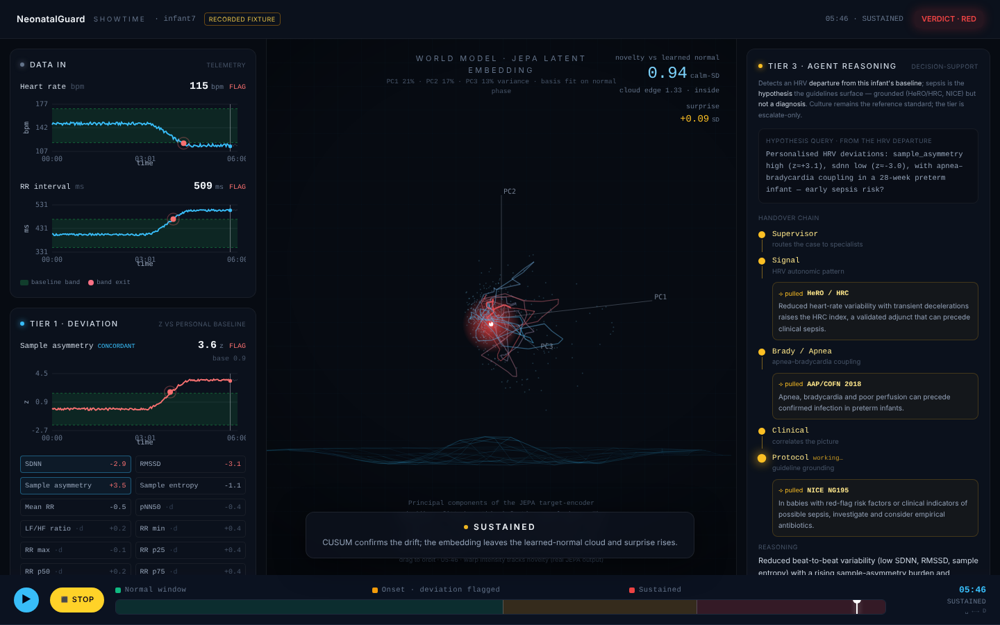
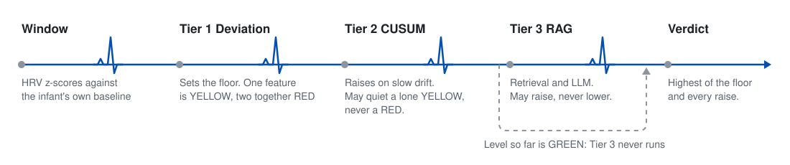

<div align="center">

# NeonatalGuard

Prototype that detects a sustained departure of an infant's heart-rate variability (HRV) from their own baseline and returns a RED / YELLOW / GREEN verdict that the language-model tier can raise but never lower; sepsis is only what the guidelines raise as a consideration, and nothing here has been tested against sepsis outcomes.

[](https://github.com/cmengu/Neonatal/actions/workflows/ci.yml)



<sub>Dashboard showtime view of infant7 (PICS, a public de-identified cohort), mid-demo. Real: the 3-D JEPA embedding, novelty and surprise, which are model outputs on infant7's recorded window. Mocked: the page is a recorded fixture, its heart-rate, RR and Tier 1/Tier 2 series are synthesized, and the Tier 3 reasoning is scripted around real guideline passages. It is not a live run and not a sepsis detection.</sub>

</div>

## Why

Sepsis in a preterm infant is hard to catch early, and HRV variability tends to fall before clinical signs (Griffin and Moorman 2001, cited in `src/assessment/deviation.py`). Population thresholds misfire on infants whose variability is naturally low, so every infant here is scored against their own history. The data is the 10-infant PICS cohort, which has no sepsis labels: the system detects a sustained departure from baseline, and sepsis is the hypothesis the guidelines attach to it, not a diagnosis.

## How it works

<picture>
  <source media="(prefers-color-scheme: dark)" srcset="docs/how-it-works-dark.svg">
  
</picture>

The Verdict Cascade (`src/assessment/cascade.py`) runs the tiers in order and returns `max(safety floor, every raise)`.

- **Tier 1, Deviation** (`deviation.py`). Counts HRV features that deviate by 2 SD or more from the infant's own baseline in their pathological direction. One feature gives YELLOW, two or more give RED. This sets the safety floor.
- **Tier 2, CUSUM** (`cusum.py`). A one-sided CUSUM (k = 0.5, h = 5) over a composite of the same deviations, kept per infant in SQLite. It raises to YELLOW on sustained drift where no single window trips Tier 1. It is the only tier allowed to quiet a single-feature YELLOW to GREEN, and only when warmed up and not building a trend. A RED is never quieted.
- **Tier 3, RAG** (`rag.py`). Runs only if the level so far is not GREEN. A LangGraph of specialists (signal, then bradycardia if `n_events > 0` or any |z| > 2, then clinical, then protocol) retrieves guideline chunks and asks an LLM for reasoning and an action. It can raise the level and never lower it.

The decisions behind this are in `docs/adr/`. A JEPA world model (`src/world_model/`) also exists as an observational assessor: it is always GREEN, cannot raise or quiet anything, and is not in the default cascade (`src/assessment/runtime.py`).

## Run it

Tiers 1 and 2 and the cascade tests need no keys. Python 3.11 or newer:

```bash
pip install -r requirements.txt
pytest -q tests/test_deviation_assessor.py tests/test_temporal_cusum.py tests/test_verdict_cascade.py
python eval/eval_agent.py --no-llm      # cascade routing gate, 30 scripted scenarios
```

The API and Tier 3 need a Groq key and the on-disk Qdrant store:

```bash
cp .env.example .env                    # set GROQ_API_KEY
uvicorn api.main:app --port 8000        # or: docker-compose up

curl -X POST http://localhost:8000/assess/infant7            # full cascade, returns a Verdict
curl -N http://localhost:8000/assess/infant7/stream          # SSE progress of the Tier 3 graph
curl -X POST http://localhost:8000/assess/infant7/generalist # single-prompt baseline, no floor
curl http://localhost:8000/patient/infant7/history           # past alerts from data/audit.db
curl http://localhost:8000/health
```

`EVAL_NO_LLM=1` makes the specialist nodes use rule-based output instead of calling Groq. `dashboard/` is a Next.js demo of one infant's trace (`cd dashboard && npm ci && npx next build && npx next start`); `docs/demo/showtime-runbook.md` says which parts are real and which are context.

## Results

| What | Result | Measured on |
|---|---|---|
| Cascade routing gate (`eval/eval_agent.py`) | macro F1 0.893, 27 of 30 correct, FNR(RED) 0.000 | 30 scripted scenarios with stand-in tiers; re-run for this edit |
| Retrieval, vector-only vs hybrid + rerank | MRR@3 0.793 vs 0.960, Recall@3 92% vs 100% | 25 query/keyword pairs, 34 chunks; recorded 2026-03-22 in `BENCHMARKS.md`, not re-run |
| JEPA onset anticipation | AUC 0.758, held out across infants, no labels used | 10 infants, 3,563 onsets; from `docs/research/world-model-jepa-result.md`, not re-run |

The routing gate checks the combining rules, not clinical accuracy. The three misses are the scenarios that expect a quiet (`EVAL-GRN-005`, `EVAL-GRN-007`, `EVAL-HARD-GRN-001`): the stand-in Tier 2 is not a `SoftFloorArbiter`, so the cascade ignores its quiet request. FNR(RED) is 0.000 by construction there, since the floor is the input. The JEPA number is a "departure from the infant's own normal" signal, not bradycardia or sepsis. The F1, latency and live-LLM figures in `BENCHMARKS.md` come from the earlier ONNX-based agent and do not describe the current code.

## Retrieval

Each Tier 3 specialist queries only its own categories of the clinical texts in `src/knowledge/clinical_texts/`: signal (`hrv_indicators`, `sepsis_early_warning`), bradycardia (`bradycardia_patterns`) and clinical (`intervention_thresholds`, `baseline_interpretation`). The protocol specialist retrieves nothing and checks the action against `APPROVED_ACTIONS`. Dense vectors (all-MiniLM-L6-v2) and TF-IDF sparse vectors are fused in Qdrant with Reciprocal Rank Fusion, then re-ranked with FlashRank ms-marco-MiniLM-L-12-v2 (`src/knowledge/knowledge_base.py`). The LLM is `llama-3.3-70b-versatile` on Groq. Every alert row in `data/audit.db` stores the z-scores and HRV values it was based on (`src/agent/memory.py`).

## Known limitations

- Nothing here has been tested against sepsis outcomes: PICS has no sepsis labels, so the system is validated only as a detector of a sustained HRV departure from the infant's own baseline, and sepsis is the consideration the guidelines raise, not something it detects or diagnoses.
- Tier 3 has not been evaluated live with an LLM in this repo; its unit tests use a fake graph.
- The CUSUM operating point (k, h) and the quiet gates are engineering constants, not calibrated on real streams (`cusum.py` docstring).
- The Tier 1 threshold is a per-infant SPC triage threshold, not a validated clinical cutoff (`deviation.py`).
- The PICS bradycardia labels are unreliable (issue #18, `docs/research/world-model-jepa-result.md`), so no result here is a supervised accuracy figure.
- The Phi-3-mini LoRA signal specialist is wired (`USE_LORA_SIGNAL=1`) but its adapter weights are not in the repo; only the training set `data/lora_training/signal_train.jsonl` is.
- `audit.db` scopes rows by `patient_id` only; there is no access control.

## Layout

```
src/assessment/   Tier 1, Tier 2, Tier 3 adapter, cascade, runtime entry point
src/agent/        Tier 3 LangGraph (supervisor, specialists), audit memory, schemas
src/knowledge/    clinical texts, Qdrant hybrid retrieval, rerank
src/world_model/  JEPA world model and leave-one-infant-out evaluation
src/features/     HRV and respiration features
api/main.py       FastAPI app
eval/             routing gate and retrieval eval
dashboard/        Next.js demo
data/processed/   per-infant feature and z-score CSVs
docs/             ADRs, research notes, demo runbooks
```
